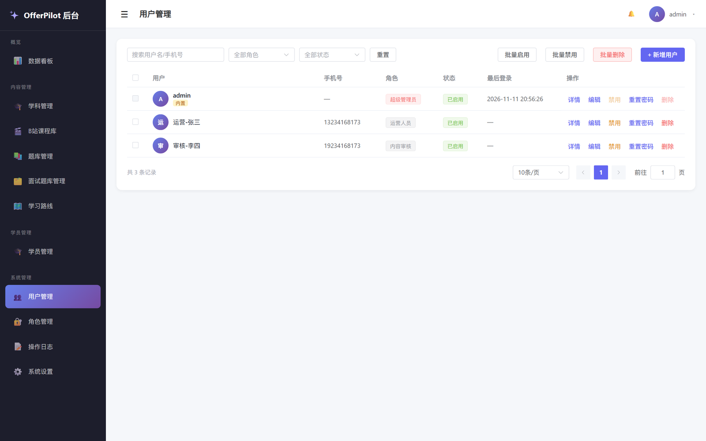
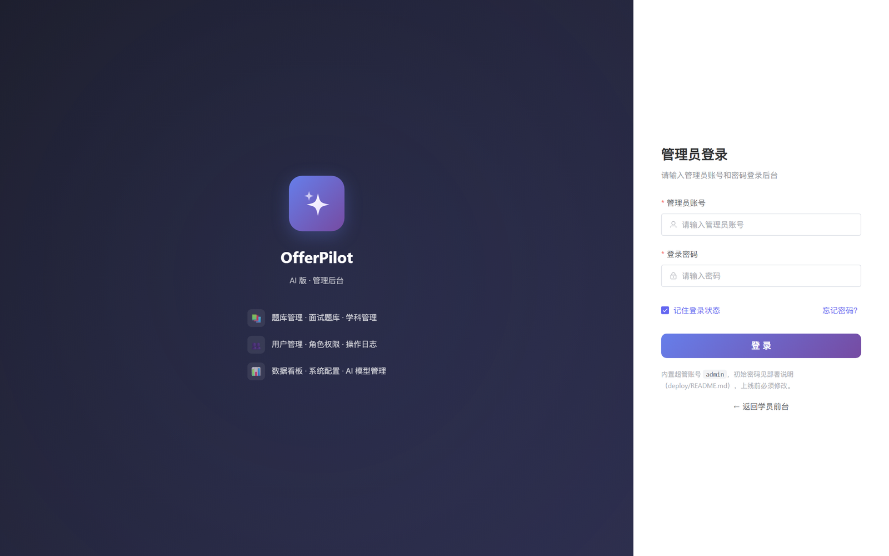
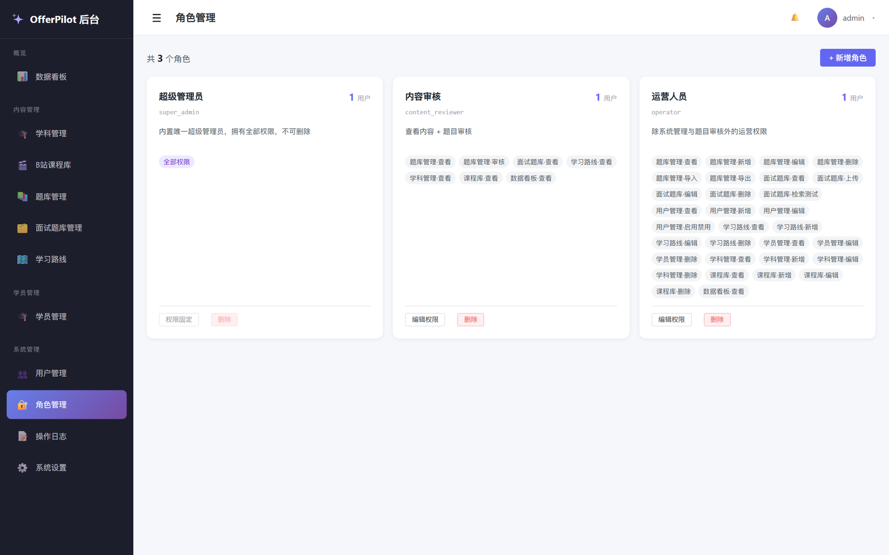
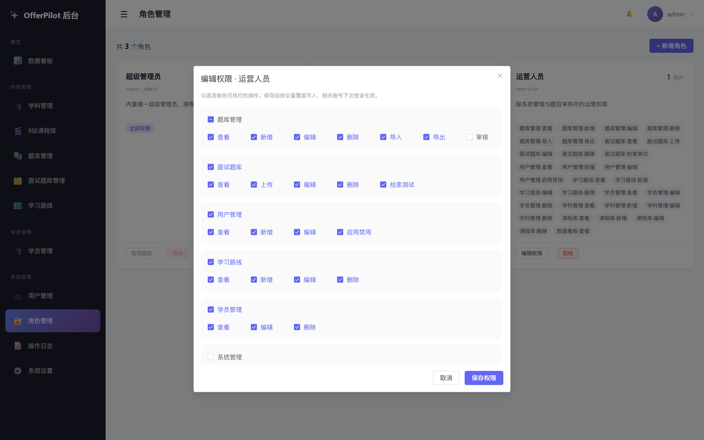
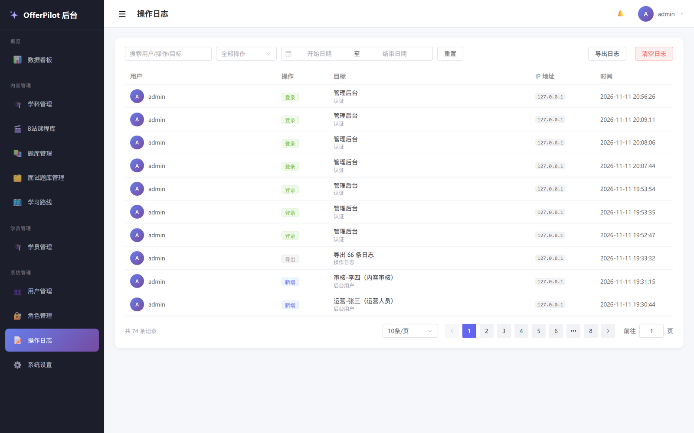
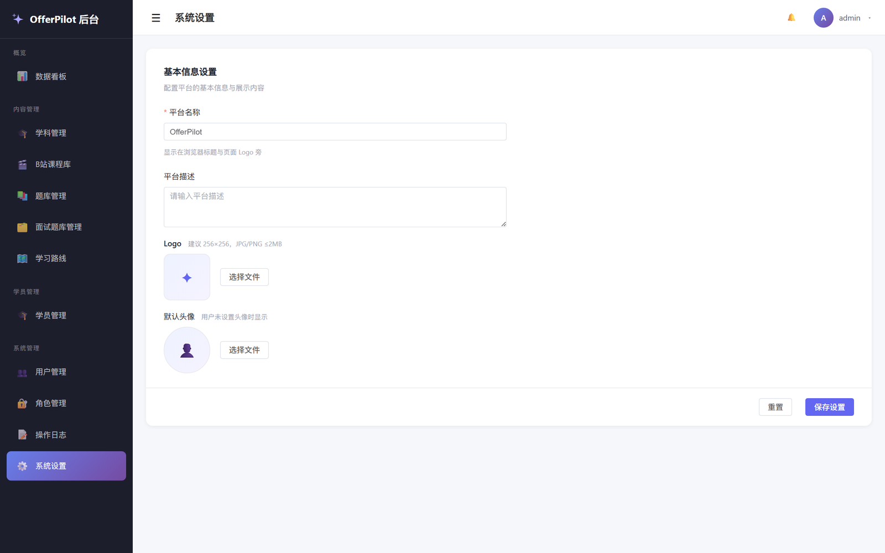
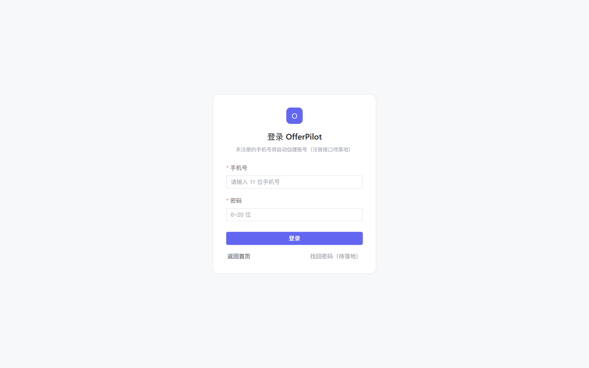
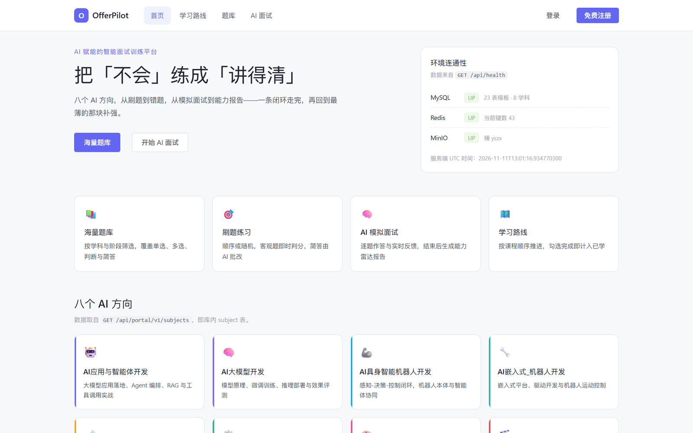
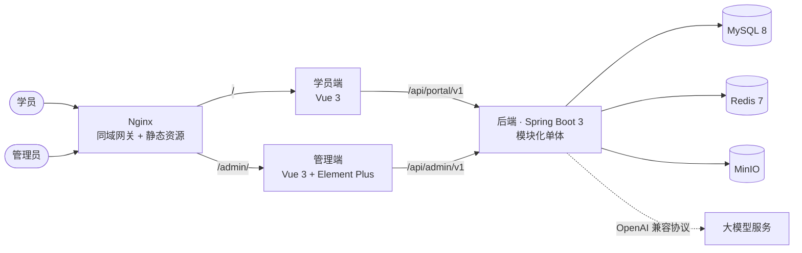

# OfferPilot · AI 技术面试训练平台

> 把「不会」练成「讲得清」——面向 AI 应用、大模型、具身智能等 8 个技术方向的面试训练平台：
> 刷题 → 错题重练 → AI 模拟面试 → 能力雷达报告 → 学习路线，闭环推进。
>
> 后端 Spring Boot 3 模块化单体，前端 Vue 3 双端（学员端 + 管理端），
> MySQL / Redis / MinIO 全容器化，一套 `docker compose up -d` 起全套依赖。



---

## 目录

- [项目简介](#项目简介)
- [界面预览](#界面预览)
- [功能现状](#功能现状)
- [技术栈](#技术栈)
- [系统架构](#系统架构)
- [快速开始](#快速开始)
- [目录结构](#目录结构)
- [设计文档](#设计文档)
- [工程约定](#工程约定)
- [已知限制](#已知限制)

---

## 项目简介

市面上的刷题产品大多停在「看答案」，而面试真正卡住人的是**说不清楚**。OfferPilot 把训练链路拆成六个可度量的环节：

| 环节 | 做什么 | 为什么这么设计 |
|---|---|---|
| 题库 | 按学科 / 阶段 / 题型筛选，覆盖单选、多选、判断、简答 | 先建立知识覆盖面的基线 |
| 刷题 | 顺序或随机作答，客观题即时判分 | 高频、低成本地把「见过」变成「会做」 |
| 错题本 | 自动归集错题，支持重练与移除 | 把复习成本集中到真正的薄弱点 |
| AI 模拟面试 | 逐题作答 + 实时反馈，结束后生成能力雷达报告 | 练「表达」而不只是练「答案」 |
| 学习路线 | 按课程顺序推进，勾选完成即计入已学 | 给出「下一步学什么」的确定路径 |
| 能力报告 | 按学科维度输出雷达图与薄弱项 | 用数据决定补哪里，而不是凭感觉 |

项目同时包含两套前端：**学员端**面向学习者，**管理端**面向内容运营与审核人员（题库维护、审核流转、学员数据、系统配置）。

> 这是一个**按真实产品规格推进中**的项目，不是在跑 Demo：数据库 23 张表、API 契约 131 个接口，按「需求 → 设计 → 数据库 → API → 后端 → 前端」分阶段落地，目前完成了系统管理域这一层。

## 界面预览

### 管理端

| 登录（品牌面板 + 表单两栏） | 用户管理（筛选 / 批量启停 / 分页 / 详情抽屉） |
|---|---|
|  |  |

| 角色管理（卡片网格，权限标签全量展示） | 角色权限配置（9 组 · 34 项，全量覆盖式授权） |
|---|---|
|  |  |

| 操作日志（含导出与清空，操作本身也审计） | 系统设置（Logo / 头像尺寸前后端双校验） |
|---|---|
|  |  |

> 数据看板页面框架已就绪（`docs/screenshots/02-admin-dashboard.png`），但四张指标卡依赖的 `stats` 聚合接口尚未实现，因此不在此展示半成品状态。

### 学员端

| 登录 | 首页 |
|---|---|
|  |  |

> 截图为本地实际运行界面，含少量演示数据（`运营-张三`、`审核-李四` 两个账号用于展示多角色权限差异）。

## 功能现状

诚实标注进度，避免让人误以为整站已完工。

### 已完成并可用

| 端 | 模块 | 已实现内容 |
|---|---|---|
| 管理端 | 登录 / 退出 | 双 JWT 域（access + refresh）、记住登录、连续失败 5 次锁定 5 分钟、登出令牌拉黑、登录登出全部审计 |
| 管理端 | 数据看板 | MySQL / Redis / MinIO 实时连通性探测，关键指标卡位（待聚合接口接入） |
| 管理端 | 用户管理 | 分页 + 关键词 / 角色 / 状态筛选、新增编辑、批量启停、删除、重置密码、详情抽屉（含最近 10 条操作日志） |
| 管理端 | 角色管理 | 角色卡片、9 组 34 项权限树（三态复选）、全量覆盖式授权、内置超管保护、被引用角色禁止删除 |
| 管理端 | 操作日志 | 分页 / 条件筛选 / 详情 / CSV 导出（UTF-8 BOM，带导出上限）/ 清空 |
| 管理端 | 系统设置 | 平台名称、描述、Logo、默认头像；后端 key 白名单 + 图片尺寸二次校验 |
| 学员端 | 登录页 / 首页 | 视觉落地，8 个 AI 方向取自 `subject` 表，环境连通性实时展示 |

### 规划中（页面骨架与接口编号已定，尚未接实现）

| 端 | 模块 |
|---|---|
| 管理端 | 学科管理、B 站课程库、题库管理、面试题库、学习路线、学员管理 |
| 学员端 | 题库、刷题、错题本、学习路线、AI 模拟面试、个人中心 |

## 技术栈

| 层 | 选型 |
|---|---|
| 后端 | Java 17 · Spring Boot 3.5 · Spring Security · MyBatis-Plus 3.5 · springdoc-openapi |
| 数据库 | MySQL 8.0（InnoDB / utf8mb4_0900_ai_ci，禁物理外键，逻辑删除） |
| 缓存与会话 | Redis 7（刷新令牌、令牌黑名单、登录失败计数、统计缓存） |
| 对象存储 | MinIO（S3 兼容，可平滑替换云 OSS / COS） |
| 管理端 | Vue 3.5 · TypeScript · Vite 5 · Element Plus · Pinia · ECharts |
| 学员端 | Vue 3.5 · TypeScript · Vite 5 · Pinia |
| 部署 | Docker Compose（MySQL / Redis / MinIO 一键起）· Nginx 同域反代 |
| 工程化 | 契约优先：springdoc 导出 OpenAPI，前端 `pnpm gen:types` 生成 TS 类型 |

## 系统架构



几个关键取舍：

- **模块化单体而非微服务**：当前体量与团队规模下，单体内按业务域分包（`modules/auth`、`modules/system`、`modules/question` …）即可获得清晰边界，避免过早分布式带来的运维成本。
- **双端独立 JWT 域**：管理端与学员端令牌的 `aud` 分别为 `admin` / `portal`，互不通用，避免「学员令牌越权访问管理接口」这类事故。
- **刷新令牌一次性消费**：Redis 存 `token:refresh:{domain}:{jti}`，刷新即 `GETDEL`，防止重放；登出把 `jti` 写入黑名单直到自然过期。
- **前端只做体验层鉴权**：路由守卫与按钮权限都是展示便利，真正的身份与权限校验全部在后端完成。

## 快速开始

### 环境要求

- JDK 17+
- Node.js 20+ / pnpm 9+
- Docker Desktop（或等价容器运行时）

### 1. 起依赖（MySQL / Redis / MinIO）

```bash
cd deploy
cp env/.env.example .env      # Windows PowerShell: Copy-Item env/.env.example .env
docker compose up -d
```

容器端口：MySQL `3307`（避开本机原生 3306）、Redis `6379`、MinIO `9000`、MinIO 控制台 `9001`。
首次启动会自动执行 `deploy/mysql/init/` 下的建库、建表、种子数据脚本。

### 2. 起后端

```bash
cd backend
mvn clean package -DskipTests
java -jar target/offerpilot.jar --server.port=8080
```

健康检查：`curl http://127.0.0.1:8080/actuator/health` → `{"status":"UP"}`
接口文档（dev 环境）：<http://127.0.0.1:8080/swagger-ui.html>

### 3. 起前端

```bash
# 管理端 → http://localhost:5174/admin/
cd admin-web && pnpm install && pnpm dev

# 学员端 → http://localhost:5173/
cd portal-web && pnpm install && pnpm dev
```

两个前端都把 `/api` 代理到 `http://127.0.0.1:8080`，无需额外配置跨域。

### 4. 登录

| 端 | 账号 | 密码 |
|---|---|---|
| 管理端 | `admin` | `Offer@2026` |

> ⚠️ 这是种子数据里的内置超管。**部署到任何非本机环境前，必须先在「用户管理 → 重置密码」改掉**，或直接改 `deploy/mysql/init/03-seed.sql` 中的哈希。
>
> 想验证多角色权限差异，可在「用户管理 → 新增」建两个账号，分别授予 `运营人员` / `内容审核` 角色，再用它们登录对比菜单与按钮的可见范围。

## 目录结构

```
OfferPilot/
├── backend/                      后端（Spring Boot 3 模块化单体）
│   └── src/main/java/com/yunshu/zhixue/
│       ├── common/               统一响应、异常处理、通用工具
│       ├── security/             JWT、令牌黑名单、权限注解、当前用户
│       └── modules/              按业务域分包：auth / system / subject / question / …
├── admin-web/                    管理端（基路径 /admin/）
│   └── src/{api,components,layouts,router,store,styles,utils,views}
├── portal-web/                   学员端
├── deploy/                       部署与基础设施
│   ├── docker-compose.yml        MySQL 8 / Redis 7 / MinIO
│   ├── mysql/init/               01 建库 · 02 建表 · 03 种子数据
│   ├── nginx/                    同域反代配置
│   ├── env/.env.example          环境变量模板（复制为 .env）
│   └── scripts/                  build.sh / deploy.sh
├── docs/                         设计规范与界面截图
│   ├── rules/                    数据库设计规范 · API 设计规范
│   └── screenshots/              真实运行界面截图
└── CLAUDE.md                     分阶段开发规则（需求 → 设计 → 数据库 → API → 后端 → 前端）
```

## 设计文档

需求规格、整体架构、数据库设计、API 契约四份文档在**本地维护，不随仓库分发**——它们基于课程提供的教学资料整理，属第三方内容。

仓库内保留两份通用规范，以及实现过程中形成的具体决策：

| 文档 | 内容 |
|---|---|
| [数据库规范](docs/rules/database-rules.md) | 命名、字段类型、索引、时区、逻辑删除约定 |
| [API 规范](docs/rules/api-rules.md) | 路径风格、错误码分段、分页、鉴权约定 |

> 双端 JWT 域隔离、软删重名的函数唯一索引、权限树全量覆盖授权这三处，是在实现中真正踩过坑之后定下来的，具体原因写在下方「工程约定」。

## 工程约定

- **时间**：数据库统一存 UTC，出参按 `Asia/Shanghai` 呈现，避免时区漂移。
- **逻辑删除**：全表 `delete_flag` 软删；配合 MySQL 8 函数唯一索引
  `UNIQUE KEY ((IF(delete_flag = 0, username, NULL)))`，解决「软删行仍占用唯一键、删了同名账号就建不回来」的经典冲突。
- **错误码**：业务码分段（`1xxxx` 通用 / `3xxxx` 业务），前端按码提示，绝不向前端抛 SQL 与堆栈。
- **契约优先**：后端注解即文档，`openapi.json` 一出，前端立刻 `pnpm gen:types` 生成类型，接口变更早发现。
- **注释只写「为什么」**：关键设计原因（为什么这样取舍）写在注释里，不重复代码字面意思。

## 已知限制

- 数据看板的聚合指标（学科数、题目数、注册用户、面试次数）目前是卡位占位，待 `stats` 模块聚合接口接入；环境连通性探测已可用。
- 学员端除首页与登录外仍是占位页，AI 模拟面试需要配置 `AI_API_KEY` 才能工作（`app.ai.*`，仅走环境变量，不落库）。
- 尚未接入自动化测试与 CI，当前验证方式为接口正反例手工回归 + `mvn test` / `vue-tsc` 静态检查。

---

项目尚在推进中，欢迎通过 Issue 交流。
